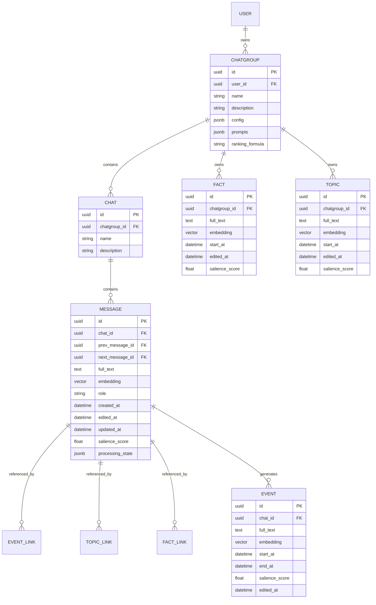

# Vistui Data Model

## Context

This document defines the core entities for the Vistui memory system. It is derived from the object hierarchy described in `startingpoint.md` and refined by the scope decisions captured in `system-overview.md`.

Key design rules:

- **ChatGroup** owns configuration, prompts, ranking formula, facts, and topics.
- **Chat** belongs to exactly one ChatGroup and owns messages and events.
- **Message** belongs to a Chat and is stored as a linked list.
- **Event**, **Topic**, and **Fact** are consolidated memory objects, each with embedding, salience score, and links to messages.
- **Embedding** and **salience score** are enrichment fields computed for all messages by the batch pipelines, even for protected (recent) messages; they are not prerequisites for consolidation, which only waits for the protected window.

## Entity relationship diagram



## Entities

### User

Represents a human user of the system.

| Field | Type | Notes |
|-------|------|-------|
| `id` | UUID | Primary key, generated by the database. |
| `name` | string | Display name. |
| `email` | string | Optional, unique if present. |
| `created_at` | datetime | Automatic. |

### ChatGroup

A grouping created by a user to hold shared memory across one or more chats. It is the primary unit of memory scoping and configuration.

| Field | Type | Notes |
|-------|------|-------|
| `id` | UUID | Primary key. |
| `user_id` | UUID | Foreign key to User. |
| `name` | string | Display name. |
| `description` | string | Optional summary. |
| `config` | JSONB | All tunable settings (see below). |
| `prompts` | JSONB | Prompt templates stored as strings. |
| `ranking_formula` | text | Name of a formula defined in the settings file's `ranking_formulas` section (default `"default"`). |
| `created_at` | datetime | Automatic. |
| `updated_at` | datetime | Automatic. |

**ChatGroup config schema (stored in `config`):**

| Setting | Purpose |
|---------|---------|
| `token_budget` | Token budget search hits are packed into; the `token_budget` query parameter overrides it per request. |
| `memory_ratio` | Category distribution used verbatim when the decision-model ratio is disabled or unusable. |
| `use_llm_memory_ratio` | If `true`, ask the decision model for the ratio on every search. If `false`, use `memory_ratio`. |
| `protected_message_count` | Number of most recent messages never added to facts/events/topics until newer messages push them out of the window. Default follows the deployment's `VISTUI_PROTECTED_MESSAGE_COUNT` setting (10). |
| `user_name` | Display name of the conversation's human participant, substituted into the topic/fact/event prompts so statements are attributed to the right speaker. `null` falls back to "the user". |
| `assistant_name` | Display name of the AI participant, same substitution. `null` falls back to "the assistant". |
| `max_facts_per_message` | Maximum number of facts a single message can create or update (default 5). |
| `max_topics_per_message` | Maximum number of topics a single message can create or update (default 5). |
| `batch_inactivity_seconds` | Seconds of inactivity before the batch worker starts. |
| `processing_timeout_seconds` | Max time a processing step may run before being marked failed (default 3600). |

**ChatGroup prompts schema (stored in `prompts`; default texts in `sources/backend/llm/prompts.py`):**

| Prompt key | Purpose |
|------------|---------|
| `salience` | Full instructions template for the salience decision question; `{kind}` is substituted with `message`/`event`/`topic`/`fact`. |
| `salience_rubric` | Ordered rubric levels (2-10, lowest first) the decision model scores against; the answer is normalized by `len - 1`. |
| `memory_ratio` | Instructions of the memory-ratio choice question (decision task). |
| `memory_ratio_criteria` | Criteria of the memory-ratio choice question, keyed by memory type (labels fixed, descriptions reworded; at least two entries, a type left out gets no retrieval share). |
| `event_boundary` | Instructions of the per-message event boundary choice question (decision task): how the message relates to the chat's last event. |
| `event_boundary_criteria` | Criteria of the boundary question — keys ⊆ `extend`/`new`/`mixed` (at least two), values their descriptions. |
| `event_summary` | Rebuild an event's summary from its full member list; must contain the `{messages}` placeholder. |
| `topic_candidate` | Maintain the chatgroup's topics — titled, additive running summaries of recurring themes; an update returns the complete new text (the body only grows: earlier lines kept, new ones appended; the title can be reworded). |
| `fact_candidate` | Maintain the chatgroup's facts — titled current-state snippets; an update fully replaces the body (the title can be reworded), and a changed truth replaces the old fact instead of coexisting with it. |

At creation, `prompts`, `ranking_formula`, and `config` are copied from system defaults unless explicitly supplied. The `topic_candidate`, `fact_candidate` and `event_summary` templates are formatted with the chatgroup's participant names (`config.user_name` / `config.assistant_name`, generic fallbacks when unset) and each message is attributed to its speaker, so statements are credited to whoever made them.

### Chat

Represents a chat window with a chatbot. Each Chat belongs to exactly one ChatGroup.

| Field | Type | Notes |
|-------|------|-------|
| `id` | UUID | Primary key. |
| `chatgroup_id` | UUID | Foreign key to ChatGroup. Immutable after creation. |
| `name` | string | Display name. |
| `description` | string | Optional summary. |
| `created_at` | datetime | Automatic. |
| `updated_at` | datetime | Automatic. |

**Auto-creation rule:** if a caller creates a Chat without specifying a ChatGroup, the API creates a new ChatGroup with the same name and description and assigns the Chat to it.

### Message

A single message inside a Chat.

| Field | Type | Notes |
|-------|------|-------|
| `id` | UUID | Primary key, caller-provided. |
| `chat_id` | UUID | Foreign key to Chat. |
| `prev_message_id` | UUID | Previous message in the linked list. Nullable for first message. |
| `next_message_id` | UUID | Next message in the linked list. Nullable for last message. |
| `full_text` | text | Full message content. |
| `embedding` | vector | Computed embedding of `full_text`. Recalculated synchronously when the text is written or edited. |
| `role` | enum | `system`, `user`, or `assistant`. |
| `salience_score` | float | Between 0 and 1, assigned by LLM. Set to `null` when the text changes; regenerated by the salience batch job. |
| `processing_state` | JSONB | See below. |
| `created_at` | datetime | Automatic. First-send time. |
| `edited_at` | datetime | When `full_text` was last written: set at creation, bumped by every later write of the field (identical-text PATCHes included). The current content's age is `edited_at`. |
| `updated_at` | datetime | Updated on any row modification. |

**Processing state (`processing_state`):**

Only the LLM consolidation flags live in `processing_state`;
the salience stage is queued by the `salience_score IS NULL` column. `embedding`
is no longer a batch-stage marker: it is computed synchronously when the text is
written. See [batch-consolidation.md](batch-consolidation.md).

```json
{
  "event": "waiting | processing | done | failed",
  "topic": "waiting | processing | done | failed",
  "fact": "waiting | processing | done | failed",
  "last_failure_at": "2026-07-11T12:00:00Z",
  "retry_count": 0
}
```

Each pipeline can be interrupted and retried independently. A state of `failed` triggers a retry. A processing step that runs longer than `processing_timeout_seconds` is marked `failed`.

- A message is eligible for event/topic/fact consolidation when it is outside the protected
  window — salience is an enrichment stage, not a prerequisite.
- `event`, `topic`, and `fact` are only run for messages outside the protected window.

**Linked list integrity:** `prev_message_id` and `next_message_id` must form a coherent sequence per Chat. Message insertion, deletion, and editing must maintain the list. The API validates that the previous and next references are consistent.

**Linked list update strategy:** The implementation keeps updates intentionally simple and robust. A message's position is determined by its own `prev_message_id`. The head of the list is the message in the Chat with no other message pointing to it. When inserting or editing a message, only the affected message's `prev_message_id` is modified; neighbors are updated by the caller or repaired by the API when the message is deleted. This avoids complex multi-row writes and reduces the risk of inconsistency, at the cost of requiring callers to provide the correct `prev_message_id` for new insertions.

### Event

A time-bounded summary of contiguous messages within a Chat, built incrementally one
message at a time: a per-message boundary decision extends the last event, opens a
new one, or does both (`mixed`) when the message spans the boundary — so a single
message can contribute to two events, and event spans have no fixed size.

| Field | Type | Notes |
|-------|------|-------|
| `id` | UUID | Primary key. |
| `chat_id` | UUID | Foreign key to Chat. |
| `full_text` | text | LLM-generated summary. |
| `search_vector` | tsvector | For full-text search. |
| `embedding` | vector | Computed embedding of `full_text`. Recalculated synchronously when the summary is written or rewritten. |
| `start_at` | datetime | Timestamp of first linked message. |
| `end_at` | datetime | Timestamp of last linked message. |
| `salience_score` | float | Between 0 and 1. Set to `null` when rewritten; regenerated by a separate salience batch job. |
| `created_at` | datetime | Automatic. |
| `updated_at` | datetime | Automatic. |

An Event links to one or more Messages via a join table `event_message_links`.
Like messages, topics and facts, an event's `edited_at` records when its text was last
written (set at creation, bumped on every later write). A rewritten event — extended
or concluded by a later message — has its summary rebuilt from the full member list
and its embedding/salience cleared for regeneration, exactly like a topic/fact update.

### Topic

A short title followed by the additive running summary of a recurring theme across non-contiguous messages in a ChatGroup. The body only grows — updates keep earlier lines and append new ones — so the theme's evolution stays visible inside it; the title can be reworded.

| Field | Type | Notes |
|-------|------|-------|
| `id` | UUID | Primary key. |
| `chatgroup_id` | UUID | Foreign key to ChatGroup. |
| `full_text` | text | LLM-generated summary. |
| `embedding` | vector | Computed embedding of `full_text`. Recalculated synchronously when the summary is written or rewritten. |
| `start_at` | datetime | First appearance timestamp. |
| `edited_at` | datetime | When the text was last written: set at creation (automatically), bumped on every later `full_text` write. |
| `salience_score` | float | Between 0 and 1. Set to `null` when rewritten; regenerated by a separate salience batch job. |
| `created_at` | datetime | Automatic. |
| `updated_at` | datetime | Automatic. |

A Topic links to non-contiguous Messages via `topic_message_links`. When updated, only the latest linked message is considered the active context; older links form history.

### Fact

A short title followed by a small body describing the current state of one specific thing about the user or the world. The body holds no history: a changed truth fully replaces it (the title can be reworded), and two conflicting facts never coexist (earlier states stay visible in events and topics).

| Field | Type | Notes |
|-------|------|-------|
| `id` | UUID | Primary key. |
| `chatgroup_id` | UUID | Foreign key to ChatGroup. |
| `full_text` | text | LLM-generated fact text. |
| `embedding` | vector | Computed embedding of `full_text`. Recalculated synchronously when the fact text is written or rewritten. |
| `start_at` | datetime | First appearance timestamp. |
| `edited_at` | datetime | When the text was last written: set at creation (automatically), bumped on every later `full_text` write. |
| `salience_score` | float | Between 0 and 1. Set to `null` when rewritten; regenerated by a separate salience batch job. |
| `created_at` | datetime | Automatic. |
| `updated_at` | datetime | Automatic. |

A Fact links to multiple Messages via `fact_message_links`. The latest linked message is the active context; older links are history. A fact can be rewritten in place when the underlying truth changes (e.g., "Mom is sick" → "Mom is on vacation").

## Join tables

| Join table | From | To | Notes |
|------------|------|----|----|
| `event_message_links` | Event | Message | Preserves order. A message may link to multiple events. |
| `topic_message_links` | Topic | Message | Preserves order of discovery. |
| `fact_message_links` | Fact | Message | Latest link is active context. |

## Scope summary

| Object | Scoped to | Lifetime |
|--------|-----------|----------|
| User | System | Persistent. |
| ChatGroup | User | Persistent. |
| Chat | ChatGroup | Persistent. Cannot change ChatGroup. |
| Message | Chat | Overwritten in place on edit. |
| Event | Chat | Built incrementally; extended or concluded by later messages (embedding/salience invalidated on rewrite). |
| Topic | ChatGroup | Rewritten when revisited. |
| Fact | ChatGroup | Rewritten when truth changes. |

## Constraints and validation

1. A Chat must always belong to exactly one ChatGroup.
2. A ChatGroup must always have at least one Chat (the auto-created one if necessary).
3. Message `prev_message_id` and `next_message_id` must be consistent within a Chat.
4. `role` must be one of `system`, `user`, `assistant`.
5. `salience_score` must be in `[0.0, 1.0]` when set; it is `null` until the salience pipeline scores the row (and stays `null` for chatgroups with `use_salience` false, which opt out).
6. `ranking_formula` must name a formula defined in the settings file's `ranking_formulas` section; the formulas themselves are lambda expressions over `(vector_score, bm25_score, salience, linked_count)`.
7. A message is eligible for event/topic/fact consolidation once it is outside its chat's protected window — `embedding` and `salience_score` are not prerequisites.
8. A `null` `salience_score` does not exclude a row from retrieval: the ranking formula gets the neutral 1.0. A `null` embedding excludes the row from the vector channel only (BM25 still finds it).

## Open questions

- Should Events be scoped to ChatGroup instead of Chat? The current design keeps them per Chat because they summarize contiguous sequences, but cross-Chat events may be useful in some companion scenarios.
- Should we store a denormalized `latest_message_id` on Fact and Topic for faster active-context lookup?

## Changelog

- 2026-11-22: All default prompt texts live in `sources/backend/llm/prompts.py`
  (decision-model and chat-model prompts together); ChatGroupPrompts references the
  constants as its field defaults. The `topic_candidate` and `fact_candidate` defaults
  are the full pipeline prompts (placeholder sentences before), so chatgroups created
  from now on store the real texts for those keys.
- 2026-11-22 (issue 007): Events are built by a per-message boundary decision
  (extend / new / mixed) against the chat's last event: spans are unbounded, summaries
  are always rebuilt from the full member list, and a rewritten event is invalidated
  like a topic/fact update (`edited_at` bumped, embedding and salience cleared). The
  `event` prompts key is replaced by `event_boundary`, `event_boundary_criteria` and
  `event_summary`.
- 2026-11-21: New prompts key `memory_ratio_criteria` (criteria descriptions of the
  memory-ratio choice question, keyed by memory type). Token estimates for retrieval
  packing are BPE counts (tiktoken `cl100k_base`), whitespace words as fallback.
- 2026-11-21: Consolidation eligibility is the protected window only (embedding and
  salience are enrichment fields, not prerequisites). `use_salience` is a plain boolean.
  `edited_at` on messages, events, topics and facts records when the text was last
  written: set at creation, bumped on every later `full_text` write (events gain the
  column; topic/fact clients no longer supply it).
- 2026-07-11: Initial data model derived from `startingpoint.md` and discussion.
- 2026-07-11: Applied feedback: memory_ratio is now a config default with optional LLM override, split fact prompts into `fact_candidate` and `fact_update`, split topic prompts into `topic_candidate` and `topic_update`, added embedding/salience as prerequisite batch pipelines.
- 2026-11-22: Removed the `topic_update`/`fact_update` prompts and their associated config (`topic_update_threshold`, `fact_update_threshold`, `fact_history_count`); `topic_candidate`/`fact_candidate` now directly return create/update/skip actions.
- 2026-11-22: Topic/fact semantics made explicit in the default prompts: topics are titled, additive running summaries (updates return the complete new text: the body only grows, the title can be reworded), facts are titled current-state snippets (updates fully replace the body, conflicting facts never coexist).
- 2026-11-22: The config gained `user_name`/`assistant_name` (display names of the conversation's participants, substituted into the topic/fact/event prompts with generic fallbacks) so statements are attributed to their author instead of generic "the user"/"the AI" labels. The candidate prompt templates are validated as format templates on write.

- 2026-11-21: `chatgroup.ranking_formula` stores the name of a formula defined in
  the settings file's `ranking_formulas` section (migration `0007` rewrote the
  built-in default formula source into `"default"`). The column keeps its name and
  type; only its semantics changed.
