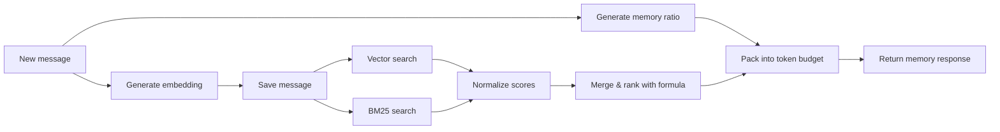

# Vistui Retrieval System

## Context

When a caller sends a new or edited message with `retrieve=true`, Vistui must return the most relevant existing memory (messages, events, topics, facts) without exceeding a token budget. This document describes the retrieval pipeline from ingestion to response packing.

## Goals

1. Return relevant memory within a bounded token budget.
2. Combine vector similarity and BM25 text search for robust matching.
3. Allow per-ChatGroup customization of ranking.
4. Use an LLM-generated memory ratio to balance memory categories per request.
5. Keep retrieval latency low enough for interactive chat use.

## Non-goals

- Perfect recall at any cost.
- Streaming retrieval responses.
- Learning user preferences from click-through feedback.

## Pipeline overview



The embedding and memory-ratio generation steps run in parallel after the message text is known.

## Step 1: generate embedding

The message `full_text` is sent to the configured embedding provider (see [`llm-provider.md`](llm-provider.md)).

- The embedding is stored on the `Message` row.
- Reused if the message is edited and the text has not changed; otherwise recomputed.

## Step 2: generate memory ratio

When the ChatGroup config flag `use_llm_memory_ratio` is `true`, the **decision model**
(the System One model configured for the `memory_ratio` task, e.g. `d3:4b` — see
[llm-provider.md](llm-provider.md)) produces the desired distribution of memory
categories for the query: one `decide()` call whose state carries the ChatGroup
description and the query, with a single choice question whose criteria are the memory
types the ChatGroup offers. The criteria come from the ChatGroup's
`memory_ratio_criteria` prompts key: the labels are fixed to the memory types (the
answer's probabilities are keyed by them and the packing looks its shares up by them),
ChatGroups reword the descriptions, and a type left out of the criteria is offered no
share. The answer's native probabilities over the criteria labels *are* the
distribution:

```json
{
  "message": 0.40,
  "event": 0.10,
  "topic": 0.30,
  "fact": 0.20
}
```

Unknown labels are dropped and the values renormalized to sum to 1; a missing label
counts as 0. An unusable answer — a decision error, absent probabilities, or nothing
surviving normalization — falls back to the `memory_ratio` stored in the ChatGroup
config, which is also used verbatim (no renormalization) whenever
`use_llm_memory_ratio` is `false`. The response reports the distribution actually
applied (`memory_ratio`) and where it came from (`ratio_source`: `"decision"` or
`"config"`).

The ratio is multiplied by the token budget to compute per-type budgets. The step is
opt-in per ChatGroup because the decision call adds several seconds to every search
(the model stays loaded between searches via `keep_alive`).

## Step 3: save the message

The message, embedding, and salience score are persisted. See [`data-model.md`](data-model.md) and [`api-contract.md`](api-contract.md). The memory ratio is not stored on the message; it is computed on demand during retrieval.

## Step 4: search the memory

Two searches are executed in parallel across the ChatGroup's memory.

### Vector search

Uses `pgvector` cosine similarity over `embedding` columns of Messages, Events, Topics, and Facts.

Search scope:

- **Messages**: only Messages in the same Chat as the new message.
- **Events**: Events in the same Chat.
- **Topics**: Topics linked to the parent ChatGroup.
- **Facts**: Facts linked to the parent ChatGroup.

The query returns top-N candidates per category with a raw vector score (e.g., `1 - cosine_distance`). Candidates without a computed embedding are excluded.

### BM25 text search

Uses the `pg_search` extension: ParadeDB BM25 over the `full_text` columns of
Messages, Events, Topics and Facts (the query string is token-quoted as literals
before parsing). Search scope is the same as vector search. The query returns
top-N candidates per category with a raw BM25 score.

## Step 5: normalize scores

Before ranking, raw scores are normalized per category to the range `[0, 1]` using the best score in the candidate set for that category and search type.

| Score | Normalization |
|-------|---------------|
| `vector_score` | `raw_vector_score / max_vector_score_in_category` |
| `bm25_score` | `raw_bm25_score / max_bm25_score_in_category` |
| `linked_count` | `raw_linked_count / max_linked_count_in_category` |

This makes heterogeneous search signals comparable and allows the ranking formula to combine them meaningfully.

No recency, message role, or other signals are used unless explicitly added by the user in the custom formula.

## Step 6: merge and rank

For each candidate, compute a final relevance score using the ChatGroup's `ranking_formula` — the *name* of an entry of the settings file's `ranking_formulas` section. ChatGroups reference formulas by name and the API accepts names only, so every formula text the evaluator sees is operator-authored settings input (evaluated with plain `eval`; see the trust note in `backend.search.scoring`). A ChatGroup whose stored name is not defined makes the search fail with `422` instead of silently scoring with another formula.

### Default formula

```python
lambda vector_score, bm25_score, salience, linked_count: max(
    vector_score, bm25_score
) * salience * link_weight(linked_count)
```

### Inputs to the formula

| Variable | Meaning |
|----------|---------|
| `vector_score` | Vector similarity normalized to 0..1. |
| `bm25_score` | BM25 relevance normalized to 0..1 against the best hit of the query. |
| `salience` | Candidate's stored `salience_score` in [0, 1]. Rows without one (not scored yet, or a chatgroup with `use_salience` false) get the neutral 1.0. |
| `linked_count` | Number of messages linked to the candidate (events, topics, facts) or 1 for raw messages. |

### Formula evaluation

- The formula is stored as a Python lambda string on the ChatGroup (`DEFAULT_RANKING_FORMULA` as the pydantic default).
- It is evaluated with plain `eval` in a namespace restricted to a few math helpers
  (`max`, `min`, `abs`, `log`, `log10`, `sqrt`, and the `link_weight` curve: 0 links →
  0.5, 100 links → 1.0, logarithmic in between). This is deliberately not a security
  boundary — accepted for the local single-user deployment, tracked as issue 001 in
  `plan/issue.md`.
- Each distinct formula string is compiled once and cached for the process lifetime.
- An invalid formula (not a lambda expression, or raising when called) makes the search
  request fail; the formula is not pre-validated at chatgroup create/update time.

## Step 7: pack into token budget

Given:

- Total token budget: the optional `token_budget` query parameter (>= 1), falling back
  to the ChatGroup config's `token_budget` (2000 by default).
- Per-type budgets: `memory_ratio * token_budget` (a type with a zero share yields
  nothing).
- Ranked candidates per type.

Packing algorithm:

1. For each type in the order `fact`, `topic`, `event`, `message` (densest first):
   1. Take the type's candidates in descending score order.
   2. Add a candidate when its token estimate fits the type's remaining share; stop at
      the first that does not (later, smaller candidates are not reconsidered).
   3. The single best hit of a type with a positive share is always included, even
      when it alone exceeds the share — a tiny budget must not silence a whole memory
      type. This is the only way a type overshoots its share.
2. Re-sort the packed hits globally by score and cap the list at `k` (default 20).
3. Sum the used tokens per type over the returned hits.

### Token estimation

`estimate_tokens(text)` counts BPE pieces of the text field with the local
`tiktoken` tokenizer (`cl100k_base`, the same library LangChain's text splitters
use; the encoding data is fetched once and cached). None of the served models uses
this exact encoding — the count is a deliberately approximate estimate, far tighter
than a whitespace split — and when the tokenizer cannot load (offline first boot,
uncached), estimation degrades to whitespace word counts rather than failing the
search. Callers re-tokenize with their own model's tokenizer when exactness matters.

## Step 8: return memory response

The search response (see [`api-contract.md`](api-contract.md)) contains the packed
hits — each carrying its token estimate — plus the bookkeeping: the effective
`token_budget`, `tokens_used` per type, the applied `memory_ratio` and its
`ratio_source`.

## Performance targets

| Metric | Target | Notes |
|--------|--------|-------|
| Retrieval latency (no LLM) | < 200 ms p95 | Embedding + search + packing. |
| Retrieval latency (with decision ratio) | + 5-10 s | One System One call per search when `use_llm_memory_ratio` is on; `keep_alive` keeps the model loaded. |
| Candidate pool size per category | 20 | `_CANDIDATE_LIMIT` in `backend.search.service`. |

## Failure handling

- If embedding generation fails: return an error; the message cannot be retrieved.
- If the memory-ratio decision fails or is unusable: fall back to the ChatGroup `memory_ratio` and continue.
- If formula evaluation fails: fall back to default formula.
- If vector or BM25 search fails partially: return results from the other search and log a warning.

## Changelog

- 2026-11-21: Token-budget packing implemented as designed here, with the as-built
  details: the ratio comes from one decision-model choice question (probabilities =
  distribution) for chatgroups opting in via `use_llm_memory_ratio`, the `token_budget`
  query parameter overrides the config default, packing stops at a type's first
  misfit and always keeps the best hit of a non-zero-share type, the final list is
  globally sorted and capped by `k`, and token counts are BPE estimates (whitespace
  words when the tokenizer cannot load). The question's criteria are configurable per
  chatgroup via the `memory_ratio_criteria` prompts key. BM25 runs over `full_text`
  (ParadeDB `parse()`), not `search_vector` columns.
- 2026-07-11: Initial retrieval system design derived from `startingpoint.md` and discussion.
- 2026-07-11: Applied feedback: score normalization documented before ranking formula, removed optional budget redistribution, removed open questions, memory ratio is generated by LLM or taken from ChatGroup config.

- 2026-11-21: Ranking formulas are named entries of the settings file's
  `ranking_formulas` section (the default also lives in code, and settings entries
  may override it or add names). ChatGroups store the name — the API accepts names
  only, unknown names are `422` on write, and an undefined stored name fails the
  search with `422`. This closes the arbitrary-code-execution issue of
  chatgroup-authored formula source.
